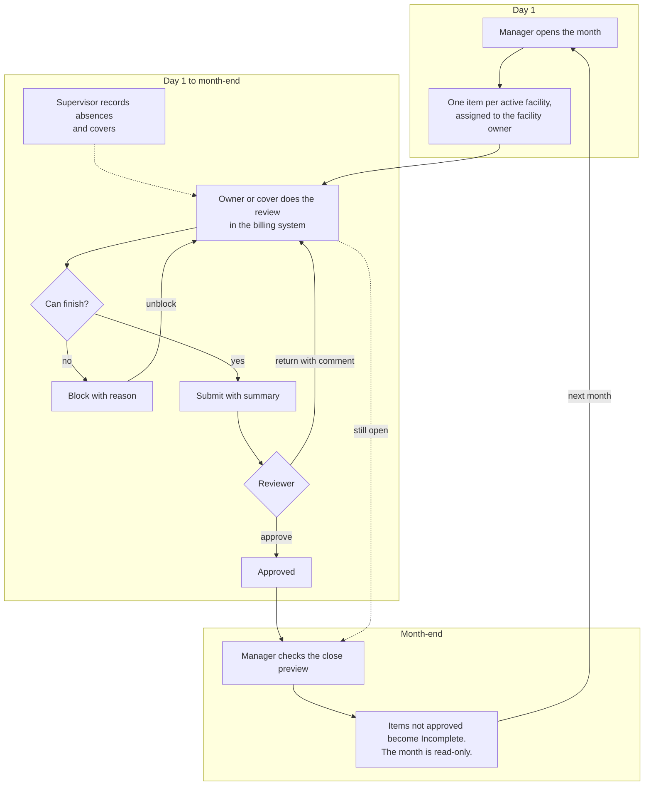
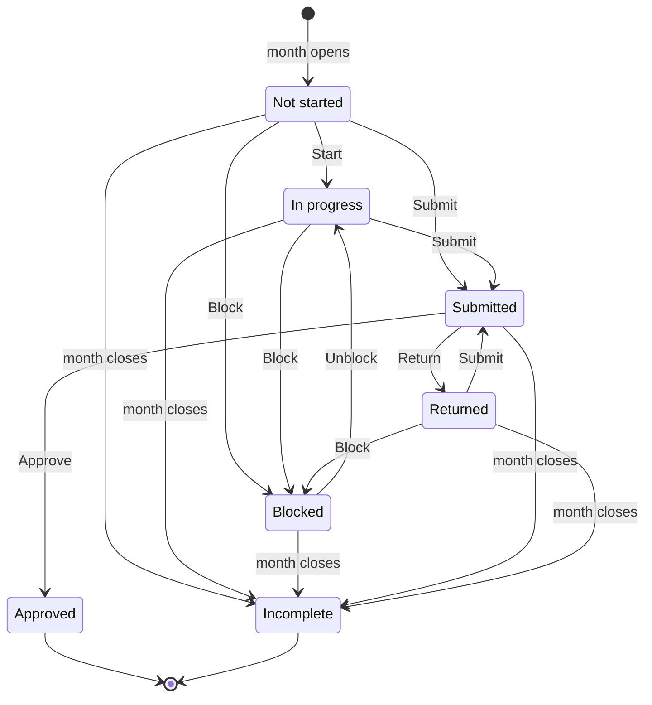

# Workflow

## Terms
- **Owner**: the item's assignee. Copied from the facility's owner when the month opens.
- **Cover**: the person covering the owner today, from an active absence.
- **Reviewer**: the person the owner reports to. If the owner reports to no one, any other manager.
- **Submitter**: whoever clicked Submit, owner or cover.
- **Open statuses**: Not started, In progress, Blocked, Submitted, Returned.
- **Today**: the date in the business time zone, not the server's.

## Monthly cycle

- The work itself happens in the billing system. The app records who owns it, where it stands and who did what.
- The manager sets the due date when opening the month. Default: the 15th.
- After the due date, open items are flagged Overdue. Nothing else changes.
- Managers chase blocked and overdue items during the month and close it once reviews are cleared.

## Statuses

| Status | Meaning |
|---|---|
| Not started | Created when the month opens |
| In progress | The owner or cover is working on it |
| Blocked | Cannot continue. Reason required |
| Submitted | The owner says it is done. Waiting for the reviewer |
| Returned | The reviewer sent it back with a comment |
| Approved | Done for this month. Final in v1 |
| Incomplete | The month closed before approval. Final |

## Transitions

| From | Action | To | Who | Rule |
|---|---|---|---|---|
| Not started | Start | In progress | Owner or cover | |
| Not started, In progress, Returned | Block | Blocked | Owner or cover | Reason required |
| Blocked | Unblock | In progress | Owner or cover | |
| Not started, In progress, Returned | Submit | Submitted | Owner or cover | Summary required |
| Submitted | Approve | Approved | Reviewer, reviewer's cover, any manager | Not the submitter |
| Submitted | Return | Returned | Reviewer, reviewer's cover, any manager | Comment required. Not the submitter |
| Any open status | Close month | Incomplete | Manager | Whole month at once, after the preview |

- Every action needs an open month and an item the user can see.
- Anyone who can see an item can comment while the month is open.
- Submitter rule in practice: a supervisor who covers their own biller can submit, and a manager then approves.
- A supervisor who wants to do an absent biller's work records themselves as the cover.
- Reopen and single-item reassignment are not in v1. See [04](04-first-version.md#whats-next).

## Visibility
- **My work**: items whose owner is me or someone I cover today.
- **Overview** (supervisors and managers): a supervisor sees items owned by themselves, by their direct reports, by anyone they cover today and by that person's direct reports. A manager sees every item.
- **Waiting for my review**: Submitted items where I am the reviewer or cover the reviewer, and I am not the submitter. A manager's right to approve any item does not put it in this list.

## Flags
Computed when read. They are not statuses, because an item can be overdue in any status.
- **Overdue**: today is after the due date and the item is not Approved or Incomplete.
- **Needs cover**: the owner is away today and has no valid cover.
- **Covered by X**: X is covering the owner today.
- **Missed last month**: last month's item for the same facility ended Incomplete.

## Covers
- An absence has a person, a start date, an end date (both inclusive), an optional cover and a note.
- During the absence the cover sees the owner's items in My work, tagged "Covering for X", and can take every owner action. A reviewer's cover can approve and return.
- The owner stays the owner. The day after the end date the cover stops. Nothing to undo.
- Events record the actor and on whose behalf they acted.
- Saving an absence is rejected when:
  - the person already has an absence on any of those days;
  - the cover is the absent person, is inactive, or is away on any of those days;
  - the cover's role ranks lower than the absent person's. Roles rank Biller, Supervisor, Manager.
- No chains. If the cover is also away on a given day, the owner's items show Needs cover that day.
- An absence can be saved without a cover. Its items show Needs cover until one is set.
- An absence starts today or later.
- Before it starts, every field can change. Once it has started, the start date stays, the end can move to any day from today on, and the cover and note can change. An absence that has ended is read-only.
- It can be deleted only before it starts.
- The Absences page shows a supervisor their own and their direct reports' absences, which they can change, and the ones they cover, read-only.
- Decision: no backdated absences. A cover only grants rights for days still ahead, and past events already record who acted. A day that was never recorded stays unrecorded.
- Decision: a cover is a dated permission, not a reassignment. One cover takes all of the owner's items; choosing per item waits for single-item reassignment.
- Decision: a cover's role must be the same or higher. A biller can never cover a supervisor, since that would let a biller approve a peer's work.

## Permanent move
- A manager picks a new owner (an active biller or supervisor) and gives a reason.
- In one transaction, the app ends the current FacilityAssignment, starts a new one and updates the facility's owner.
- "Also move this month's open item" is on by default. When on, an open item gets the new owner and a Reassigned event. A Submitted item keeps its submitter, and the new owner's reviewer reviews it.
- Approved and Incomplete items never move, so history stays true.
- Months opened later use the new owner.
- An inactive facility cannot move, and a move to the current owner is rejected.
- Decision: a move ignores absences. If the new owner is away today with no cover, the moved item shows Needs cover until someone sets one. The cost is a moved item nobody can work for a few days; the gain is that ownership and covers stay independent.

## Opening and closing a month
- Open: manager only. No other month may be open. It must be the month after the latest one. The due date must fall inside the month.
- Opening creates one Not started item per active facility, owned by the facility's owner and linked to last month's item.
- Close: manager only. The preview lists every item not Approved, Submitted ones included.
- Closing sets those items to Incomplete with one event each, in one transaction. The month becomes read-only.
- Decision: close unfinished items as Incomplete instead of carrying them over. The cost is late completion: work finished after the close does not count for that month. Carrying over would let an item span months and blur monthly reporting.
