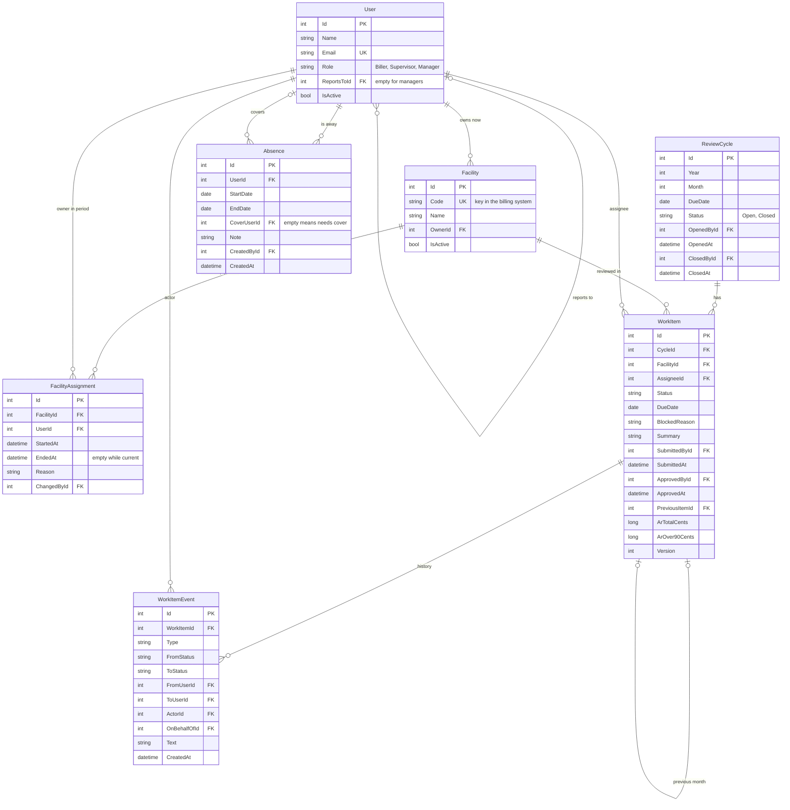

# Data model

## Notes
- **User.** ReportsToId is empty for managers. Supervisors can own facilities.
- **Facility.** Code is the facility's key in the billing system; the import matches on it. OwnerId is the current owner.
- **FacilityAssignment.** One row per ownership period. EndedAt is empty for the current one.
- **ReviewCycle.** One per calendar month (unique Year and Month). At most one is Open.
- **WorkItem.** One per facility per month (unique CycleId and FacilityId). Status values are in [02](02-workflow.md#statuses). DueDate is copied from the month so one item can get more time later. SubmittedById drives the submitter rule. Balance columns are empty until imported; the seed fills them.
- **WorkItemEvent.** Append-only. Type is Created, StatusChanged, Commented or Reassigned. OnBehalfOfId is set when a cover acts.
- **Absence.** StartDate and EndDate are inclusive.
- **Indexes.** WorkItem (AssigneeId, CycleId). WorkItemEvent (WorkItemId, CreatedAt). Absence (UserId, StartDate). Plus the unique keys above.

## Decisions
- **One work item per facility per month.** Matches the review the brief describes. Individual accounts are not tracked (see below).
- **Reviewer derived, not stored.** It comes from the owner's ReportsToId when someone acts, so pending reviews follow a reporting change. Nothing records who was meant to review; the events record who approved.
- **Current state plus a log, written together.** Facility.OwnerId with FacilityAssignment, and WorkItem status fields with WorkItemEvent. Lists read one table and history is never edited. The price is two copies of the truth; one handler writes each pair in one transaction.
- **Balances on WorkItem.** Same grain as the review. Limit: one snapshot per month.
- **Amounts as cents in `long`.** Exact, and a native integer on SQLite and SQL Server: sorting and indexes work in any tool. The model has no money type; the API and UI convert to dollars.
- **Timestamps as UTC `DateTime`, dates as `DateOnly`.** SQLite cannot compare or sort `DateTimeOffset` in SQL. No offset is stored; the business time zone comes from config.
- **Comments are events.** One timeline per item in one table. Downside: some columns stay empty for some event types.
- **Int `Version` as the concurrency token.** SQLite has no database-generated tokens, so the app increments it. It works the same on SQL Server.
- **Enums stored as text.** Readable in the database and safe to reorder.

## History we keep
- Every status change, comment and reassignment, with the actor and on whose behalf. Never edited or deleted.
- Facility ownership periods.
- Closed months and their items, read-only.
- Absences, past ones included.
- Not kept: who viewed what. Production adds access logs if the app ever holds PHI.

## No patient-level data
- An account-level AR line (resident, account number, payer, dates of service, balance) is PHI under HIPAA. Account numbers are one of the 18 Safe Harbor identifiers, so a list without names is still PHI.
- PHI brings duties a prototype cannot meet (access logging, encryption at rest, hosting rules) and breach risk. This repo is public.
- The problems in the brief sit at facility level: owner, status, cover, month-end. Account detail already lives in the billing system. We point to it instead of copying it.
- The cost: the app cannot show which accounts inside a facility are stuck. That is the likely next step, and it would make this a PHI system.
- Comments and summaries are free text, so they are the leak path. The UI warns against names and account numbers.
